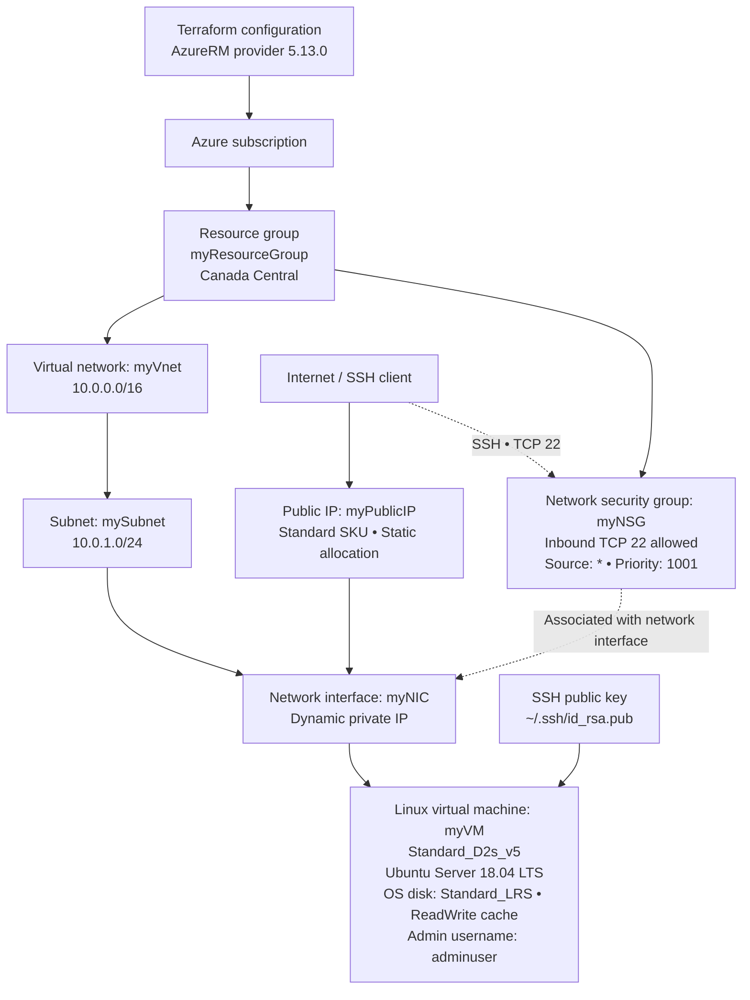

# Run

```bash
git clone https://github.com/atulkamble/Terraform-AzureVM.git
cd Terraform-AzureVM
chmod +x script.sh
./script.sh
```

# Azure Linux VM Architecture

This diagram represents the resources and Terraform relationships defined in this repository.



## Resource relationships

- The resource group contains the virtual network, public IP, network security group, network interface, and virtual machine.
- The subnet belongs to the virtual network. The network interface connects to that subnet and receives a dynamically allocated private IP.
- The static Standard public IP is attached to the network interface.
- The network security group is associated with the network interface and permits inbound SSH on TCP port 22 from any IPv4 source (`*`).
- The VM uses the SSH public key at `~/.ssh/id_rsa.pub` and a Standard_LRS OS disk.

## Security considerations

- The SSH rule allows connections from any source. Restrict `source_address_prefix` to a trusted public IP or CIDR range.
- The sample configuration contains an administrator password in plaintext. Do not commit real credentials; rotate any real password that has been exposed and use a secret store or another secure input method.
- The diagram intentionally omits the subscription ID and password.
- Ubuntu Server 18.04 LTS is an older image choice. Confirm support and image availability for the target subscription and region before deployment.
